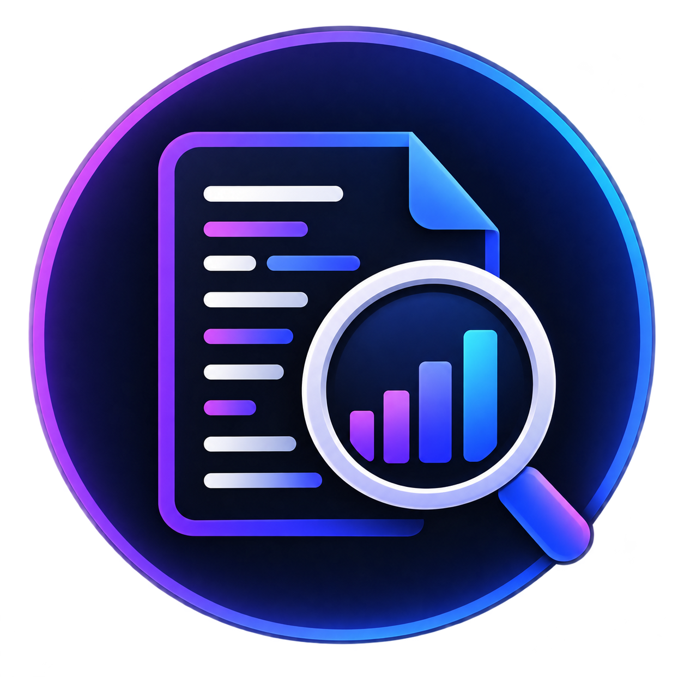

<div align="center">



# 📊 Log Analyzer

### Análise e priorização de alertas recorrentes em logs

Aplicação web desenvolvida em **Python** para transformar registros de log em informações úteis para equipes de suporte e desenvolvimento. O dashboard identifica alertas recorrentes, agrupa padrões semelhantes, prioriza eventos e apresenta os resultados de forma visual e interativa.

[](https://log-analyzer-app.vercel.app/)


[Acessar demonstração](https://log-analyzer-app.vercel.app/) · [Ver repositório](https://github.com/virla-carlos/bigdata-log-analyzer-web)

</div>

---

## 🎯 Sobre o projeto

Sistemas e aplicações podem gerar milhares ou milhões de registros de log durante sua execução. Em cenários de suporte e investigação de incidentes, analisar esse volume manualmente dificulta a identificação dos erros mais recorrentes e torna o diagnóstico inicial mais demorado.

O **Log Analyzer** foi desenvolvido para apoiar essa etapa da investigação. A aplicação identifica registros classificados como alerta, agrupa padrões semelhantes, calcula sua recorrência e apresenta os resultados em um dashboard web.

O objetivo não é diagnosticar automaticamente a causa raiz nem aplicar correções no sistema analisado. A proposta é oferecer evidências que ajudem equipes de suporte e desenvolvimento a direcionar melhor suas investigações.

---

## 🔄 Evolução do projeto

O projeto foi iniciado como uma aplicação desktop em **Python**, com interface em **Tkinter** e gráficos em **Matplotlib**, para validar o fluxo de análise dos dados.

Após validar a lógica de filtragem, agrupamento e priorização, a solução evoluiu para esta versão web. A análise permanece no back-end em Python, enquanto a interface passou a ser apresentada por um dashboard desenvolvido com HTML, CSS, JavaScript e Chart.js.

---

## ✨ Funcionalidades

A versão atual permite:

- Identificar registros classificados como alerta;
- Agrupar alertas por padrão de mensagem;
- Calcular e ordenar as ocorrências por recorrência;
- Calcular os quartis Q50 e Q75;
- Classificar padrões em níveis de risco;
- Exibir indicadores gerais da análise;
- Visualizar gráficos interativos;
- Consultar o ranking completo dos padrões;
- Filtrar resultados por prioridade;
- Pesquisar por `EventId` ou padrão de mensagem;
- Ordenar a tabela de resultados.

---

## 🧠 Fluxo da aplicação

```text
Dataset estruturado
      ↓
Python + Pandas
      ↓
Filtragem dos alertas
      ↓
Agrupamento dos padrões
      ↓
Contagem das ocorrências
      ↓
Cálculo de Q50 e Q75
      ↓
Classificação de prioridade
      ↓
Flask API
      ↓
JSON
      ↓
JavaScript + Chart.js
      ↓
Dashboard Web
```

A lógica de análise fica no back-end em Python. O front-end consome a API, monta os indicadores, gera os gráficos e disponibiliza filtros, busca e ordenação.

---

## 📊 Dataset

O projeto foi inicialmente construído a partir do **BGL (Blue Gene/L)**, dataset disponibilizado pelo LogHub, usado para estudar a estrutura de logs e validar o fluxo de análise.

A versão publicada utiliza uma **amostra experimental com logs customizados**, criada para representar cenários de suporte de forma didática, como falhas de sincronização, ordens não recebidas, problemas de autenticação, tokens expirados, dispositivos offline e erros HTTP.

> Os registros do dataset experimental são fictícios e não representam dados de produção, usuários ou sistemas reais.

O dataset mantém uma estrutura com campos como:

| Campo | Descrição |
|---|---|
| `Label` | Classificação do registro |
| `EventId` | Identificador associado a um padrão de log |
| `EventTemplate` | Representação generalizada da mensagem |
| `Level` | Nível de severidade |
| `Component` | Componente associado ao evento |
| `Date` | Data do registro |
| `Content` | Mensagem original do log |
| `Node` | Nó ou equipamento relacionado ao evento |

No fluxo atual, `Label = "-"` representa um evento normal. Registros com outros valores são tratados como alertas.

### EventId e EventTemplate

O `EventId` identifica um padrão de mensagem; ele não representa necessariamente um código de erro ou um nível de severidade.

O `EventTemplate` é uma versão generalizada da mensagem. Por exemplo:

```text
Ordem 12345 não recebida no dispositivo A01
Ordem 67890 não recebida no dispositivo B02
```

podem ser agrupados em um único padrão:

```text
Ordem <*> não recebida no dispositivo <*>
```

Esse agrupamento permite identificar quais tipos de alerta se repetem com maior frequência.

---

## 🚨 Classificação de prioridade

Após identificar os padrões, a aplicação contabiliza suas ocorrências e calcula:

```text
Q50 → mediana da distribuição das ocorrências
Q75 → terceiro quartil da distribuição
```

A regra atual é:

```text
Ocorrências <= Q50
→ RISCO BAIXO

Ocorrências > Q50 e <= Q75
→ RISCO MÉDIO

Ocorrências > Q75
→ RISCO ALTO
```

A prioridade é definida principalmente pela recorrência. Uma evolução futura pode combinar recorrência e severidade para compor uma classificação mais completa.

---

## 📈 Resultados da amostra experimental

Na amostra usada no dashboard atual:

```text
2.000 registros analisados
1.857 registros normais
143 registros de alerta
16 padrões de alerta identificados
```

O padrão mais recorrente foi:

```text
EventId: E55
Ocorrências: 59
```

Ele representa aproximadamente **41,26%** dos alertas. Os limites calculados foram:

```text
Q50 = 3,5
Q75 = 8,25
```

Além disso, **5 dos 16 padrões identificados concentram 80% dos registros de alerta**, evidenciando o valor da análise de Pareto para priorizar a investigação.

---

## 📉 Dashboard e visualizações

O dashboard apresenta indicadores como total de alertas, quantidade de padrões, Q50, Q75 e concentração dos alertas no padrão mais recorrente.

As visualizações disponíveis são:

1. **Padrões que mais se repetem:** gráfico de barras horizontal comparando `EventId` e quantidade de ocorrências, com linhas de referência para Q50 e Q75.
2. **Distribuição por prioridade:** comparação entre a proporção de padrões e registros em risco alto, médio e baixo.
3. **Alertas por dia:** gráfico temporal para identificar concentrações de alertas ao longo do tempo.
4. **Concentração dos alertas (Pareto):** relaciona ocorrências e percentual acumulado para destacar os padrões prioritários.
5. **Alertas por componente:** mostra os componentes com maior quantidade de registros classificados como alerta.

O ranking completo também permite filtrar por prioridade, buscar por `EventId` ou mensagem e ordenar os resultados pela tabela.

---

## 🏗️ Arquitetura

```text
bigdata-log-analyzer-web/
│
├── data/
│   └── sample/             # datasets utilizados pela aplicação
│
├── public/
│   ├── assets/
│   │   └── logo.png        # logo exibida no README
│   ├── app.js              # consumo da API e interação do dashboard
│   ├── index.html          # estrutura da interface
│   └── style.css           # estilos e responsividade
│
├── src/
│   ├── __init__.py
│   ├── main.py             # processamento e análise com Pandas
│   └── server.py           # API Flask
│
├── .gitignore
├── README.md
└── requirements.txt
```

### Responsabilidade dos principais arquivos

| Arquivo | Responsabilidade |
|---|---|
| `src/main.py` | Carrega os dados, filtra alertas, agrupa padrões, calcula ocorrências e classifica prioridades. |
| `src/server.py` | Disponibiliza a análise por meio da API Flask. |
| `public/app.js` | Consome a API, gera gráficos, preenche indicadores e controla busca, filtros e ordenação. |
| `public/index.html` | Define a estrutura do dashboard. |
| `public/style.css` | Define a apresentação visual e a responsividade da interface. |

---

## 🔄 Comunicação entre front-end e back-end

Ao solicitar a análise, o JavaScript chama o endpoint:

```javascript
fetch("/api/analysis")
```

O fluxo de dados é:

```text
app.js
   ↓
Flask
   ↓
server.py
   ↓
generate_analysis()
   ↓
main.py
   ↓
Pandas
   ↓
JSON
   ↓
Dashboard
```

Os dados exibidos não são definidos manualmente no HTML: eles são gerados pela análise realizada no back-end e retornados pela API em JSON.

---

## 🛠️ Tecnologias utilizadas

| Área | Tecnologias |
|---|---|
| Back-end | Python, Flask |
| Análise de dados | Pandas |
| Front-end | HTML5, CSS3, JavaScript |
| Visualização | Chart.js |
| Ferramentas e deploy | Git, GitHub, Vercel |

---

## 🚀 Executando localmente

### 1. Clone o repositório

```bash
git clone https://github.com/virla-carlos/bigdata-log-analyzer-web.git
cd bigdata-log-analyzer-web
```

### 2. Crie e ative o ambiente virtual

```bash
python -m venv .venv
```

No Windows:

```bash
.venv\Scripts\activate
```

### 3. Instale as dependências

```bash
pip install -r requirements.txt
```

### 4. Execute a API

```bash
python src/server.py
```

A aplicação ficará disponível em:

```text
http://127.0.0.1:5000/api/analysis
```

---

## ☁️ Deploy

A versão publicada está disponível na Vercel:

**https://log-analyzer-app.vercel.app/**

O fluxo de publicação é:

```text
Código local
     ↓
Git
     ↓
GitHub
     ↓
Vercel
     ↓
Build e deploy
```

Após novos `pushes` para o repositório conectado, a Vercel pode iniciar um novo deployment automaticamente.

---

## ⚠️ Limitações atuais

A versão atual:

- Utiliza uma amostra experimental de 2.000 registros;
- Trabalha com `EventId` e `EventTemplate` previamente estruturados;
- Não gera padrões diretamente a partir de arquivos de log brutos;
- Não realiza monitoramento em tempo real;
- Não diagnostica automaticamente a causa raiz;
- Não executa correções no sistema analisado;
- Baseia a prioridade principalmente na recorrência;
- Ainda não possui integração com banco de dados.

---

## 🗺️ Próximas evoluções

- Processar o dataset BGL completo e outros conjuntos de dados;
- Ler arquivos de log brutos pela aplicação;
- Gerar `EventTemplate` automaticamente;
- Permitir upload de arquivos pela interface;
- Integrar a aplicação a um banco de dados SQL;
- Combinar recorrência e severidade na prioridade;
- Criar análises temporais mais avançadas;
- Explorar técnicas de Machine Learning e Inteligência Artificial para auxiliar na interpretação dos padrões.

---

## 🎓 Contexto acadêmico

Projeto desenvolvido para a disciplina de **Tópicos de Big Data em Python**, aplicando práticas de desenvolvimento como discovery, definição de problema, planejamento, MVP, versionamento com Git, separação de responsabilidades, desenvolvimento incremental, análise de dados, visualização, documentação e deploy.

<div align="center">

### 📌 Versão atual


**Dataset → Pandas → Análise → Priorização → Flask → API → Dashboard**

</div>
